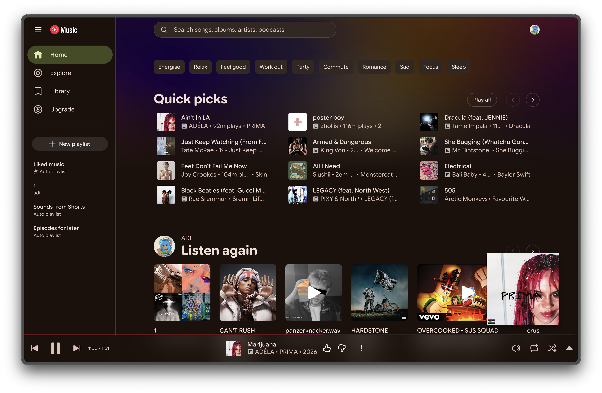
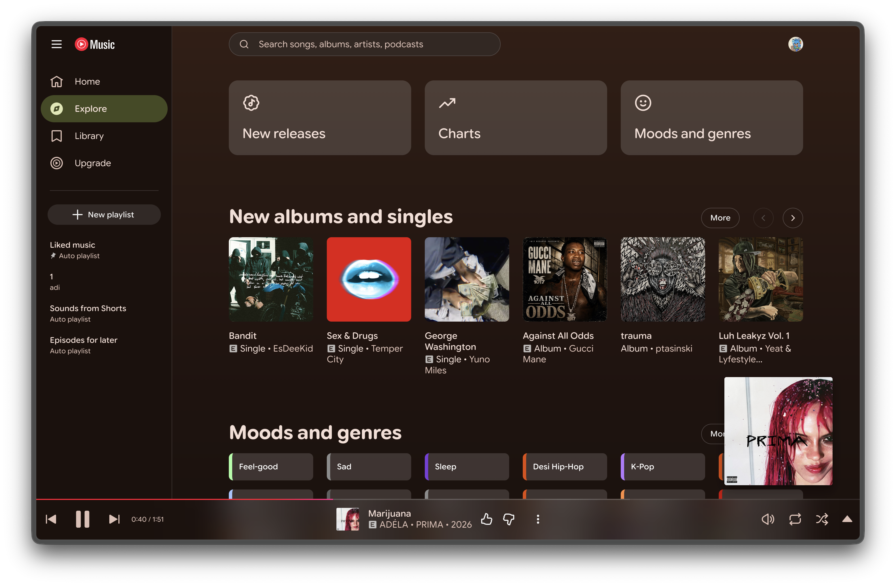

# Material 3

Bring a polished Material 3 feel to YouTube Music with a theme designed for Better Lyrics. Material 3 Expressive combines a warm dark foundation with vivid accent colors, rounded surfaces, clear typography, and subtle visual depth inspired by Material You.

The theme keeps the music experience comfortable for long listening sessions while giving every part of YouTube Music a more cohesive and expressive identity.

## Highlights

- Dark, low-distraction interface that is easy on the eyes
- Dynamic color-inspired accents that add personality without overwhelming the content
- Expressive rounded controls and cards across the music library
- Clear, readable typography for playlists, albums, artists, and navigation
- Refined playback controls and layouts for a consistent experience
- Dedicated visual treatment for lyrics, including large artwork and high-contrast text
- Updated Home and Explore pages with colorful sections, charts, releases, and mood categories

## Preview

### Home

The Home page brings together quick picks, personalized recommendations, playlists, and playback controls in a colorful, easy-to-scan layout.

### Lyrics

The Lyrics view puts the current artwork and synchronized lyrics at the center, with a soft atmospheric background and focused navigation tabs.

### Explore

Explore new releases, charts, moods, and genres through spacious cards and expressive accent colors while keeping the navigation familiar.

## Theme details

| Style | Description |
| --- | --- |
| Color | Dark surfaces with colorful, dynamic-color-inspired accents |
| Layout | Minimal, spacious, and organized for quick scanning |
| Focus | Better readability for lyrics and everyday music browsing |
| Compatibility | Built for Better Lyrics on YouTube Music |

## Credits

Created by [adidotzip](https://github.com/adidotzip).
